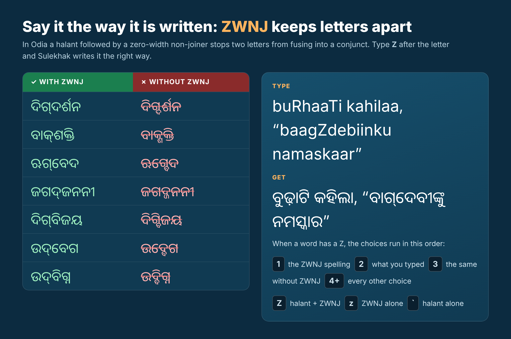
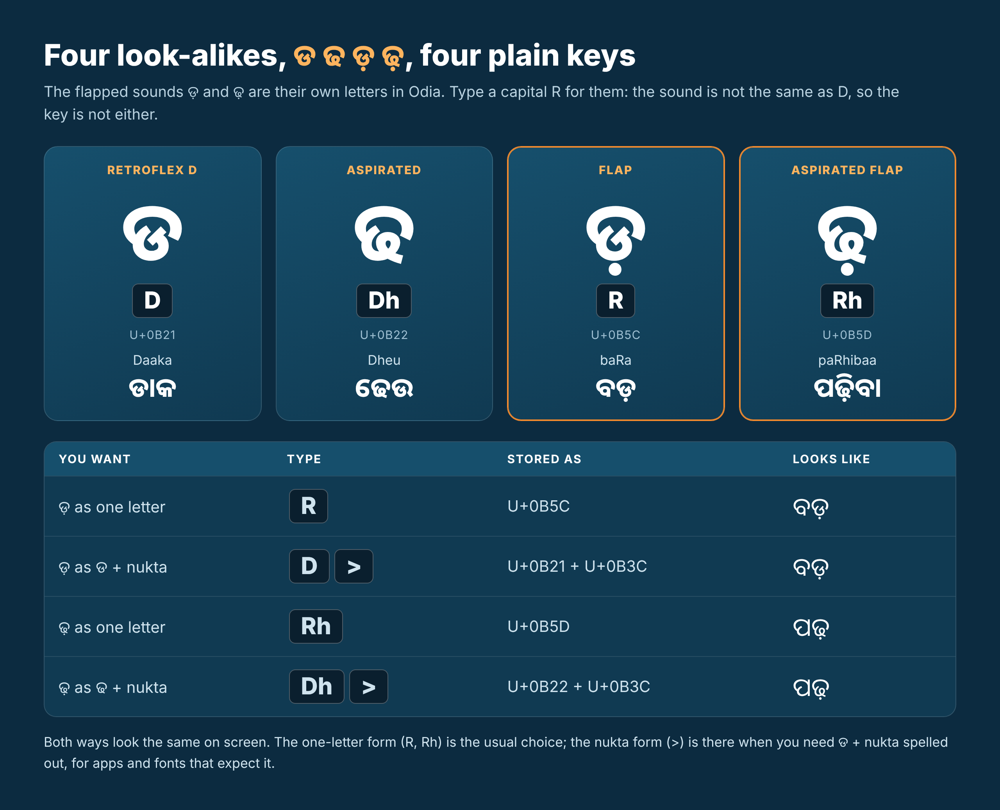

  

# ସୁलेখk · Sulekhak Indic Phonetic Keyboard

## type your way

**Type in your own language with plain English letters. Odia comes first.** Say it the way it sounds: `buRhaaTi kahilaa, "baagZdebiinku namaskaar"` → ବୁଢ଼ାଟି କହିଲା, "ବାଗ୍‌ଦେବୀଙ୍କୁ ନମସ୍କାର". A small box offers real words, Sulekhak learns the ones you pick, and after each word it suggests the next one.

## 🗣️ Languages and writing styles

| | Script | What you get |
|---|---|---|
| **ଓଡ଼ିଆ** | **Odia** | The main language. Smart word choices (vowels optional), conjuncts, next-word suggestions, and the rare letters ୠ ଌ ୡ ଽ ୰ |
| **देवनागरी** | **Devanagari** | Hindi and other languages written in Devanagari, with a choice of full conjuncts (कुण्डल) or anusvara ं |
| **मराठी** | **Marathi** (Devanagari) | Switch the **Marathi ळ** option on and `kuNDaLa` gives **कुण्डळ**; with it off, **कुण्डल** |
| **অসমীয়া** | **Assamese** | Assamese letters **ৰ** and **ৱ** (`byavahar` → ব্যৱহাৰ), kept apart from the Bangla ra and ba. Wherever ত্ is possible, the **ৎ** spelling is offered right beside it (`jagat` → জগত · জগৎ) |
| **বাংলা** | **Bangla** | Bangla script from the same keys and the same dictionary |
| **English** | Mixed typing | Every choice list also offers what you typed, so English words sit between Odia words |
| **IPA · extIPA · IAST** | Phonetic symbols (web, Mac, Windows) | Type a key, then pick the symbol that looks like it |

The same word in each script: `kuNDaLa` → କୁଣ୍ଡଳ (Odia) · कुण्डल (Devanagari) · कुण्डळ (Marathi option) · কুণ্ডল (Bangla)

## ✨ ZWNJ done right
Type **Z** after the letter to get a halant followed by a zero-width non-joiner, so the letters stay apart the way Odia is written. `Z` is halant + ZWNJ, `z` is ZWNJ alone (hold `z` on a phone or in the key guide for **ZWJ**), and the backtick is the halant alone. In a word with a Z the choices run: the ZWNJ spelling, what you typed, the same without ZWNJ, the same with ZWJ, then every other choice. `bagdebi` also finds **ବାଗ୍‌ଦେବୀ** straight away.

In the choice list the three look different on purpose: halant + ZWNJ is shown as **୍ + ┊**, halant + ZWJ as **୍ + [**, and a plain halant is just **୍**.

| ZWNJ (✓) | Without ZWNJ (✗) |
|---|---|
| ଦିଗ୍‌ଦର୍ଶନ | ଦିଗ୍ଦର୍ଶନ |
| ବାକ୍‌ଶକ୍ତି | ବାକ୍ଶକ୍ତି |
| ଋଗ୍‌ବେଦ | ଋଗ୍ବେଦ |
| ଜଗଦ୍‌ଜନନୀ | ଜଗଦ୍ଜନନୀ |
| ଦିଗ୍‌ବିଜୟ | ଦିଗ୍ବିଜୟ |
| ଉଦ୍‌ବେଗ | ଉଦ୍ବେଗ |
| ଉଦ୍‌ବିଗ୍ନ | ଉଦ୍ବିଗ୍ନ |

Both spellings are valid, and both are in the dictionary: ବାଙ୍‌ମୟ / ବାଙ୍ମୟ · ତତ୍‌ସମ / ତତ୍ସମ · ତଦ୍‌ଭବ / ତଦ୍ଭବ.

Want the ya-phala form of ର୍ୟ? A ZWJ between the ra and the halant gives **ର‍୍ୟ** (ର + ZWJ + ୍ + ୟ).

## ଡ ଢ ଡ଼ ଢ଼
`D` ଡ · `Dh` ଢ · `R` ଡ଼ (U+0B5C) · `Rh` ଢ଼ (U+0B5D). Type `>` after `D` or `Dh` for the nukta spelling (ଡ + ଼). Both look the same on screen.

## ⬇️ Download

Every platform comes as the **all-in-one** (Odia first, then Devanagari, Assamese, Bangla and Phonetic IPA) and as a **separate keyboard for each language**. Install only the language you write, or the all-in-one.

| | 🍎 Mac (DMG) | 🪟 Windows | 🤖 Android | 🌐 Web |
|---|---|---|---|---|
| **All-in-one** | [Sulekhak-All-in-one](https://github.com/Sai-sudeep/Sulekhak-Indic-Phonetic-Keyboard/releases/latest) · or [Sulekhak-Mac.zip](https://github.com/Sai-sudeep/Sulekhak-Indic-Phonetic-Keyboard/raw/main/Sulekhak-Mac.zip) (builds on your Mac) | [Sulekhak-Windows.exe](https://github.com/Sai-sudeep/Sulekhak-Indic-Phonetic-Keyboard/releases/latest/download/Sulekhak-Windows.exe) | [Sulekhak-Android.apk](https://github.com/Sai-sudeep/Sulekhak-Indic-Phonetic-Keyboard/releases/latest/download/Sulekhak-Android.apk) | [sulekhak.html](https://sai-sudeep.github.io/assets/tools/sulekhak.html) |
| **ଓଡ଼ିଆ Odia** | Sulekhak-Odia-<version>.dmg | Sulekhak-Windows-Odia.exe | Sulekhak-Android-Odia.apk | [sulekhak-odia.html](https://sai-sudeep.github.io/assets/tools/sulekhak-odia.html) |
| **देवनागरी Devanagari** (Marathi option) | Sulekhak-Devanagari-<version>.dmg | Sulekhak-Windows-Devanagari.exe | Sulekhak-Android-Devanagari.apk | [sulekhak-devanagari.html](https://sai-sudeep.github.io/assets/tools/sulekhak-devanagari.html) |
| **অসমীয়া Assamese** | Sulekhak-Assamese-<version>.dmg | Sulekhak-Windows-Assamese.exe | Sulekhak-Android-Assamese.apk | [sulekhak-assamese.html](https://sai-sudeep.github.io/assets/tools/sulekhak-assamese.html) |
| **বাংলা Bangla** | Sulekhak-Bangla-<version>.dmg | Sulekhak-Windows-Bangla.exe | Sulekhak-Android-Bangla.apk | [sulekhak-bangla.html](https://sai-sudeep.github.io/assets/tools/sulekhak-bangla.html) |
| **IPA · extIPA · IAST** | Sulekhak-Phonetic-IPA-<version>.dmg | Sulekhak-Windows-Phonetic.exe | (not on Android yet) | [sulekhak-phonetic.html](https://sai-sudeep.github.io/assets/tools/sulekhak-phonetic.html) |
| **English** | (use the all-in-one) | (use the all-in-one) | (use the all-in-one) | [sulekhak-english.html](https://sai-sudeep.github.io/assets/tools/sulekhak-english.html) |

All the DMGs, EXEs and APKs are on the [Releases page](https://github.com/Sai-sudeep/Sulekhak-Indic-Phonetic-Keyboard/releases/latest); GitHub builds them from the source in this repository. A **DMG** holds the keyboard, an *Install* file (double-click it; the first time right-click → Open) and an *Uninstall* file. Editions are separate programs with their own names, so you can have several side by side (they share the Control+Option+K hot key and your learned words). The Mac DMGs, like the rest of the Mac build, are not notarised by Apple.

## 📸 See it

## 🚀 Install on a Mac in 3 steps
1. Unzip the download and double-click **Build and Install.command**. First time only: macOS may say the file is from the internet. Right-click it → Open → Open. If a window asks for the Command Line Tools, let it install, then double-click the file again. The installer also fetches the word lists (about 8 MB) once from the project site, so it needs the internet the first time.
2. Click the input icon in the menu bar and choose **ସୁलेখk**. Not in the list? System Settings → Keyboard → Input Sources → + → Odia → ସୁलेখk.
3. Start typing in any app. 🎉

Installing again later updates the keyboard in place and keeps your own words.

Output script: from the input-source menu, or Control+Option+1 Odia, 2 Devanagari, 3 Bangla, 6 Assamese, 7 Phonetic (IPA, extIPA, IAST). Control+Option+4 switches the Marathi ळ option on and off.

**3D on-screen keyboard.** The input menu has "3D keyboard: show / hide" (also Control+Option+K). It is the same keyboard as in the web tool, drawn as a Mac, Windows, iPad or Android keyboard, and clicking its keys types through the input method. macOS asks once for the Accessibility permission, which it needs to accept key presses from an on-screen keyboard. Make it bigger or smaller with the − and + buttons, **Control+Option+=** and **Control+Option+-**, or the matching input-menu items.

**Hover to see (Phonetic keyboard).** Point at a key on the 3D keyboard and a ring of bevelled tiles opens around it, one tile for every IPA, extIPA or IAST symbol that looks like that key. The strongest match is at the top, then clockwise; the small light under each tile is green (strong), yellow (medium) or orange (weak). Click a tile to type that symbol.

**What it learns (Mac, v17 / 3.0).** While you type, the Mac app keeps the words you pick, how often, and in which script, in one readable file, `~/Library/Application Support/LekhaniOdia/sulekhak-learn.json` ([format](docs/learning-cache-format.md)). The web typist can import it ("Import learning file") so the online suggestions improve too, and `tools/learn_merge.py` turns it into the plain word lists the Windows and Android apps read.

**Add to Sulekhak Dictionary (Mac).** Select a word or an expression in any app and add it to your own dictionary: click the small **+** that appears beside a mouse selection, press **Control+Option+D** (works for a keyboard selection too), use the input menu item, the **+ Dict** button of the 3D keyboard, or right-click → Services → *Add to Sulekhak Dictionary*. A box shows the word and a Roman spelling guessed for it; change it if you like, then add. Dictionary words are trusted (never filtered out as impossible spellings) and are stored in the same learning file and in `lexicon.tsv`.

## 🪟 Windows and 🤖 Android
- **Android: [Sulekhak-Android.apk](https://github.com/Sai-sudeep/Sulekhak-Indic-Phonetic-Keyboard/releases/latest/download/Sulekhak-Android.apk)** (a debug-signed keyboard app, so Android asks you to allow installing from your browser or files app). Install it, open **Sulekhak**, switch the keyboard on, then choose it as your input method. It has the web keyboard's QWERTY layout, a number pad, symbols, emoji and Odia-letter pages, suggested next words, a globe key (and a long press on space) to change keyboard, a long press on a letter for its matras and conjuncts, and a long press on the full stop for all punctuation.
- **Windows: [Sulekhak-Windows.exe](https://github.com/Sai-sudeep/Sulekhak-Indic-Phonetic-Keyboard/releases/latest/download/Sulekhak-Windows.exe)** (one file, runs from the tray). While it is on, Roman letters you type are collected in a small candidate window and the Odia word is typed into the program you are using. **Ctrl+Alt+O** switches it on and off; **Ctrl+Alt+P** switches to Phonetic (IPA) mode; **Ctrl+Alt+K** shows the 3D on-screen keyboard. It needs the Microsoft Edge WebView2 runtime (already present on current Windows 10 and 11). It is a keyboard-hook program, not a system input method, so it does not work inside programs that run as administrator. Windows may show a "SmartScreen" warning because the file is not code-signed: choose **More info, Run anyway**.

Both keep the words you pick and offer them first next time. These two apps were built and compiled by GitHub but have had less hands-on testing than the Mac and web versions, so please report anything odd in [Issues](https://github.com/Sai-sudeep/Sulekhak-Indic-Phonetic-Keyboard/issues).

## ✍️ How to use
Type Odia the way it sounds, in English letters. A small box shows choices:

| Do this | To get this |
|---|---|
| 1–9 or click a choice | pick it (a space follows) |
| Space | accept the highlighted choice |
| Enter | accept it with a space; press again for a new line |
| ↑ ↓ Tab | move the highlight · ← → change page |
| Backspace | removes one letter · Esc cancels |
| Z / z / ` (backtick) | halant + ZWNJ (୍‌) / ZWNJ alone (hold for ZWJ) / halant (୍) |
| > | nukta (଼) for ଡ଼ ଢ଼ |

Good to know
- 🧠 Vowels optional. `pasnd`, `kn`, `pustk`, `krishna` find real words even if you skip or mix up vowels.
- ❜ Apostrophe words. `kn` / `ka'na` → କ'ଣ · `tr` → ତା'ର · `mr` → ମୋ'ର · `ma` → ମା'
- 🔤 Abbreviations. `pa` → ପି.ଏ. (also PA, P.A., ପିଏ)
- ୟ vs ଯ: `kaifiyat` → କୈଫିୟତ୍. At the start of a word `y` gives ଯ (`yoga` → ଯୋଗ).
- Z after a word (`ghar` + Shift+Z) gives ଘର୍‌ (halant + ZWNJ) first, not a guess.
- 🔤 Whatever you typed is always choice 2, in every language, so the plain English word is one number key away.
- ⌨️ The on-screen keyboard changes its key letters with the language you pick (Odia, Devanagari, Assamese, Bangla, Phonetic).
- 📒 Add your own words in `~/Library/Application Support/LekhaniOdia/lexicon.tsv` (roman⇥odia).

## 🌐 Try it in the browser
Same engine, no install: [Sulekhak, the web typist](https://sai-sudeep.github.io/assets/tools/sulekhak.html). It also writes Devanagari, Assamese (ৰ, ৱ), Bangla, English, and a **Phonetic** mode: type a key, then pick the IPA, extIPA or IAST symbols that *look like* that key (hover a key, or long-press it on a phone or iPad, to see them all). It has a realistic 3D keyboard guide drawn as the keyboard you use (Mac, Windows, iPad / iPhone or Android) that can be detached, pinned, zoomed and resized, and it works on phones and tablets: hold and drag the space bar to move the cursor, hold the full stop for every punctuation mark, open the symbols and emoji page from the bottom-left key, double-tap a word, triple-tap a paragraph, drag the selection handles.
It also plugs into [OMMNISKRIPT](https://sai-sudeep.github.io/assets/tools/ommniskript.html) as a "Write in" pad.

## 📄 License
CC BY-NC-SA 4.0: share and adapt with credit, not for commercial use, and keep the same license. The download includes the full source, so you can read how it works.

© 2026 Sai Sudeep Das
