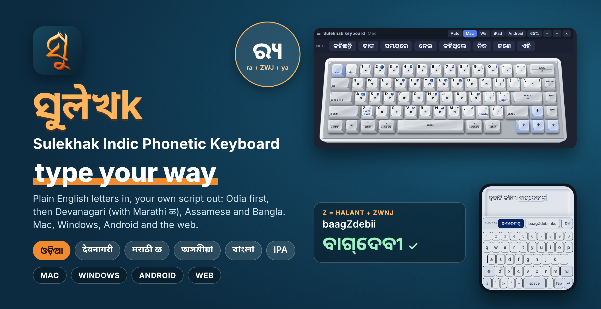
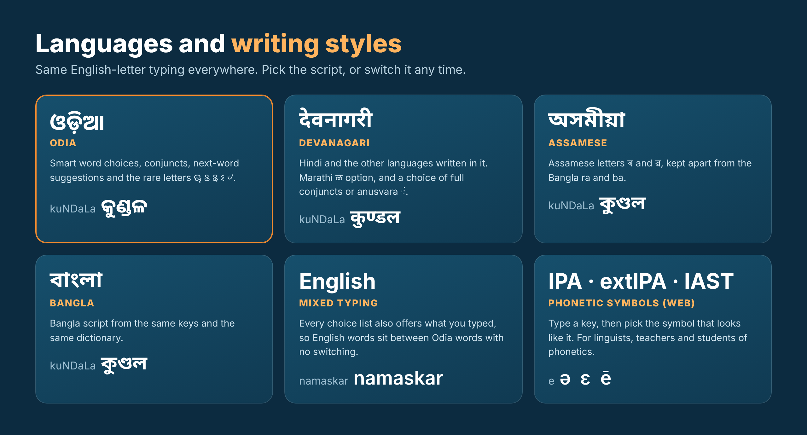
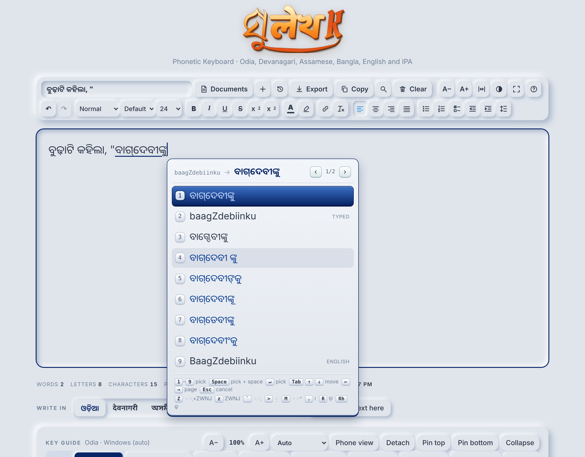
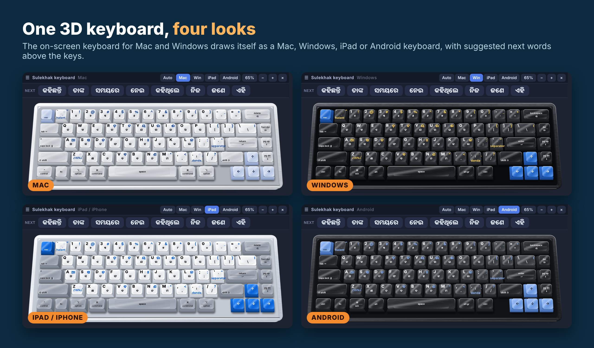
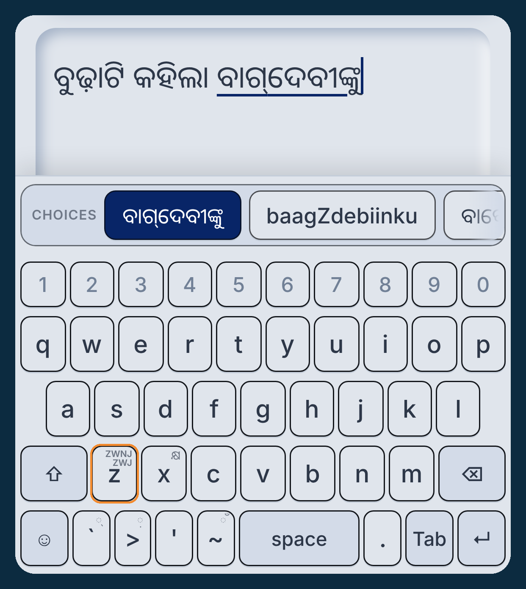

  

# ସୁलेখk: Phonetic Keyboard (Sulekhak)

**Type in your own language with plain English letters.** Say it the way it sounds: `namaskar` → ନମସ୍କାର · `pasnd` → ପସନ୍ଦ · `budhiani` → ବୁଢ଼ିଆଣୀ. A small box offers real words, Sulekhak learns the ones you pick, and after each word it suggests the next one.

## 🗣️ Languages and writing styles

| | Script | What you get |
|---|---|---|
| **ଓଡ଼ିଆ** | **Odia** | The main language. Smart word choices (vowels optional), conjuncts, next-word suggestions, and the rare letters ୠ ଌ ୡ ଽ ୰ |
| **देवनागरी** | **Devanagari** | Hindi and other languages written in Devanagari. A **Marathi ळ** option, and a choice of full conjuncts (कुण्डल) or anusvara ं |
| **অসমীয়া** | **Assamese** | Assamese letters **ৰ** and **ৱ**, kept apart from the Bangla ra and ba |
| **বাংলা** | **Bangla** | Bangla script from the same keys and the same dictionary |
| **English** | Mixed typing | Every choice list also offers what you typed, so English words sit between Odia words |
| **IPA · extIPA · IAST** | Phonetic symbols (web, Mac, Windows) | Type a key, then pick the symbol that looks like it |

The same word in each script: `kuNDaLa` → କୁଣ୍ଡଳ · कुण्डल · কুণ্ডল

## ⬇️ Download

| Platform | Download | |
|---|---|---|
| 🍎 **Mac** | [**Sulekhak-Mac.zip**](https://github.com/Sai-sudeep/Sulekhak/raw/main/Sulekhak-Mac.zip) | A real Mac input method with next-word suggestions (also on the Touch Bar, if your Mac has one) and a 3D on-screen keyboard. [Install in 3 steps](#-install-on-a-mac-in-3-steps) |
| 🪟 **Windows** | [**Sulekhak-Windows.exe**](https://github.com/Sai-sudeep/Sulekhak/releases/latest/download/Sulekhak-Windows.exe) | One file, runs from the tray, no installer. [Details](#-windows-and--android) |
| 🤖 **Android** | [**Sulekhak-Android.apk**](https://github.com/Sai-sudeep/Sulekhak/releases/latest/download/Sulekhak-Android.apk) | A keyboard app for your phone. [Details](#-windows-and--android) |
| 🌐 **Web** | [**Open the typist**](https://sai-sudeep.github.io/assets/tools/sulekhak.html) | Nothing to install. Works on phones and tablets too |

All downloads are on the [Releases page](https://github.com/Sai-sudeep/Sulekhak/releases/latest) (Windows and Android) and in this repository (Mac). The Android and Windows files are built by GitHub from the source in the `apps` folder every time it changes.

## 📸 See it

## 🚀 Install on a Mac in 3 steps
1. Unzip the download and double-click **Build and Install.command**. First time only: macOS may say the file is from the internet. Right-click it → Open → Open. If a window asks for the Command Line Tools, let it install, then double-click the file again. The installer also fetches the word lists (about 8 MB) once from the project site, so it needs the internet the first time.
2. Click the input icon in the menu bar and choose **Sulekhak Keyboard**. Not in the list? System Settings → Keyboard → Input Sources → + → Odia → Sulekhak Keyboard.
3. Start typing in any app. 🎉

Installing again later updates the keyboard in place and keeps your own words.

Output script: from the input-source menu, or Control+Option+1 Odia, 2 Devanagari, 3 Bangla, 6 Assamese, 7 Phonetic (IPA, extIPA, IAST).

**3D on-screen keyboard.** The input menu has "3D keyboard: show / hide" (also Control+Option+K). It is the same keyboard as in the web tool, drawn as a Mac, Windows, iPad or Android keyboard, and clicking its keys types through the input method. macOS asks once for the Accessibility permission, which it needs to accept key presses from an on-screen keyboard. Make it bigger or smaller with the − and + buttons, **Control+Option+=** and **Control+Option+-**, or the matching input-menu items.

## 🪟 Windows and 🤖 Android
- **Android: [Sulekhak-Android.apk](https://github.com/Sai-sudeep/Sulekhak/releases/latest/download/Sulekhak-Android.apk)** (a debug-signed keyboard app, so Android asks you to allow installing from your browser or files app). Install it, open **Sulekhak**, switch the keyboard on, then choose it as your input method. It has the web keyboard's QWERTY layout, a number pad, symbols, emoji and Odia-letter pages, suggested next words, a globe key (and a long press on space) to change keyboard, a long press on a letter for its matras and conjuncts, and a long press on the full stop for all punctuation.
- **Windows: [Sulekhak-Windows.exe](https://github.com/Sai-sudeep/Sulekhak/releases/latest/download/Sulekhak-Windows.exe)** (one file, runs from the tray). While it is on, Roman letters you type are collected in a small candidate window and the Odia word is typed into the program you are using. **Ctrl+Alt+O** switches it on and off; **Ctrl+Alt+P** switches to Phonetic (IPA) mode; **Ctrl+Alt+K** shows the 3D on-screen keyboard. It needs the Microsoft Edge WebView2 runtime (already present on current Windows 10 and 11). It is a keyboard-hook program, not a system input method, so it does not work inside programs that run as administrator. Windows may show a "SmartScreen" warning because the file is not code-signed: choose **More info, Run anyway**.

Both keep the words you pick and offer them first next time. These two apps were built and compiled by GitHub but have had less hands-on testing than the Mac and web versions, so please report anything odd in [Issues](https://github.com/Sai-sudeep/Sulekhak/issues).

## ✍️ How to use
Type Odia the way it sounds, in English letters. A small box shows choices:

| Do this | To get this |
|---|---|
| 1–9 or click a choice | pick it (a space follows) |
| Space | accept the highlighted choice |
| Enter | accept it with a space; press again for a new line |
| ↑ ↓ Tab | move the highlight · ← → change page |
| Backspace | removes one letter · Esc cancels |
| ` (backtick) / z / Z | halant (୍) / ZWNJ / halant + ZWNJ |
| > | nukta (଼) for ଡ଼ ଢ଼ |

Good to know
- 🧠 Vowels optional. `pasnd`, `kn`, `pustk`, `krishna` find real words even if you skip or mix up vowels.
- ❜ Apostrophe words. `kn` / `ka'na` → କ'ଣ · `tr` → ତା'ର · `mr` → ମୋ'ର · `ma` → ମା'
- 🔤 Abbreviations. `pa` → ପି.ଏ. (also PA, P.A., ପିଏ)
- ୟ vs ଯ: `kaifiyat` → କୈଫିୟତ୍. At the start of a word `y` gives ଯ (`yoga` → ଯୋଗ).
- Z after a word (`ghar` + Shift+Z) gives ଘର୍‌ (halant + ZWNJ) first, not a guess.
- 📒 Add your own words in `~/Library/Application Support/Sulekhk/lexicon.tsv` (roman⇥odia).

## 🌐 Try it in the browser
Same engine, no install: [Sulekhak, the web typist](https://sai-sudeep.github.io/assets/tools/sulekhak.html). It also writes Devanagari, Assamese (ৰ, ৱ), Bangla, English, and a **Phonetic** mode: type a key, then pick the IPA, extIPA or IAST symbols that *look like* that key (hover a key, or long-press it on a phone or iPad, to see them all). It has a realistic 3D keyboard guide drawn as the keyboard you use (Mac, Windows, iPad / iPhone or Android) that can be detached, pinned, zoomed and resized, and it works on phones and tablets: hold and drag the space bar to move the cursor, hold the full stop for every punctuation mark, open the symbols and emoji page from the bottom-left key, double-tap a word, triple-tap a paragraph, drag the selection handles.
It also plugs into [OMMNISKRIPT](https://sai-sudeep.github.io/assets/tools/ommniskript.html) as a "Write in" pad.

## 📄 License
CC BY-NC-SA 4.0: share and adapt with credit, not for commercial use, and keep the same license. The download includes the full source, so you can read how it works.

© 2026 Sai Sudeep Das
